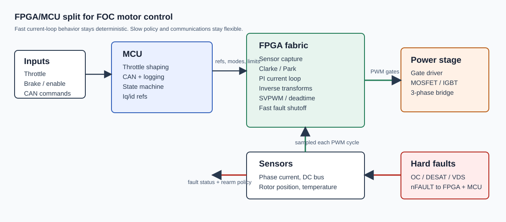
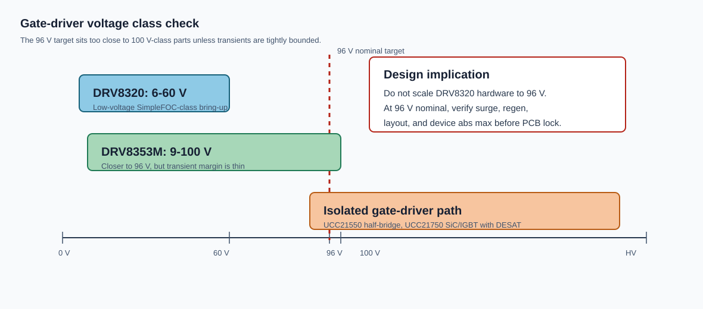
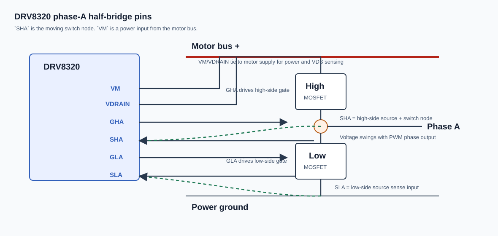
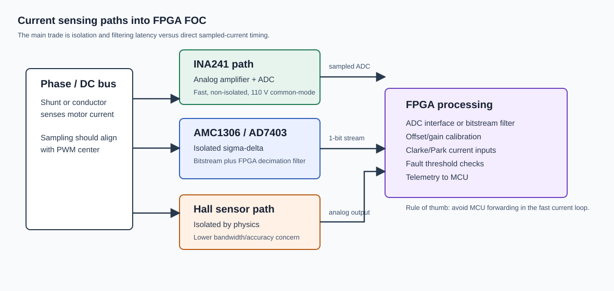

# Research Log: Datasheet Research for FPGA/MCU Field-Oriented Motor Control

## 1. Metadata & Source Citations
- **Source Type:** Datasheets; reference designs; vendor manuals; product documentation; official MATLAB/Simulink examples.
- **Key Authors/Entities:** Texas Instruments; MathWorks; SimpleFOC; Terasic; Intel FPGA; STMicroelectronics; Kelly Controls; Prohelion; Analog Devices; Littelfuse/IXYS.
- **Temporal Context:** Sources reviewed June 29, 2026. DRV8320 revised March 2022. DRV8353M active 100 V gate-driver datasheet consulted. SimpleFOC DriveShield v1.2 released August 24, 2024. TIDA-01418 revised April 2018. UCC21550 revised August 2024. UCC21750 revised January 2023. AD7403 revised December 2023. INA241 revised December 2024.
- **Figures:** Original schematic summaries derived from the cited datasheets and vendor examples.

## 2. Core Thesis & Primary Findings
- **The Main Argument:** FPGA value appears when deterministic current-loop FOC, PWM/SVPWM, sensor capture, and fast shutdown live in hardware. MCU value remains supervisory: throttle mapping, CAN, logging, state control, calibration, and non-critical safety policy.

- **Critical Insights:**
  * DRV8320 is a 6-60 V three-phase MOSFET gate driver. It fits low-voltage bring-up, not direct 96 V inverter hardware. Source: [TI DRV8320 datasheet](https://www.ti.com/lit/ds/symlink/drv8320.pdf).
  * SimpleFOC DriveShield v1.2 is a useful schematic study only. Its release lists DRV8320H, 3PWM, 30 V MOSFETs, ACS712 30 A sensing, and 30 V max input. Source: [SimpleFOC DriveShield v1.2](https://github.com/simplefoc/SimpleFOC-driveShield/releases).
  * DRV8353M is closer to a 96 V target. It is a 9-100 V triple half-bridge MOSFET gate driver, but 96 V nominal leaves little transient headroom. Source: [TI DRV8353M datasheet](https://www.ti.com/lit/ds/symlink/drv8353m.pdf).
  * Isolated gate drivers are the cleaner high-voltage direction. UCC21550 supports isolated half-bridge drive. UCC21750 supports SiC/IGBT drive with DESAT protection. Sources: [UCC21550 datasheet](https://www.ti.com/lit/ds/symlink/ucc21550.pdf), [UCC21750 datasheet](https://www.ti.com/lit/ds/symlink/ucc21750.pdf).
  * Current sensing is an architecture-defining choice. INA241 supports non-isolated PWM-rejection shunt sensing to 110 V common-mode. AMC1306 and AD7403 support isolated shunt measurement through digital bitstreams. Sources: [INA241 datasheet](https://www.ti.com/lit/ds/symlink/ina241a.pdf), [AMC1306 datasheet](https://www.ti.com/lit/gpn/AMC1306M05), [AD7403 datasheet](https://www.analog.com/media/en/technical-documentation/data-sheets/ad7403.pdf).
  * MathWorks already documents the intended partition pattern. High-rate algorithm blocks generate HDL; low-rate blocks generate C for an ARM processor. Sources: [HDL Coder PMSM partitioning](https://www.mathworks.com/help/hdlcoder/ug/field-oriented-control-of-a-PMSM.html), [Motor Control Blockset FPGA FOC example](https://www.mathworks.com/help/mcb/gs/foc-pmsm-using-mcb-blocks-fpga-hardware.html).

## 3. Granular Evidence & Data Breakdown
- **Quantitative Data:**

  * DRV8320 operating range: `VM = 6-60 V`.
  * DRV8320 drives three high-side and three low-side N-channel MOSFETs.
  * DRV8320 gate drive: 10 mA-1 A source; 20 mA-2 A sink.
  * DRV8320 applied PWM input frequency: `0-200 kHz`, thermal limits apply.
  * DRV8320 `DVDD` regulator external load: `0-30 mA`.
  * DRV8320 `SHA` pin: phase-A high-side source/switch node. It is not a logic signal.
  * DRV8320 `SHA/SHB/SHC` feed the VDS monitor and high-side sink reference.
  * DRV8320 `VM` pin: gate-driver power input. It connects to motor supply and `VDRAIN`.
  * SimpleFOC DriveShield v1.2 max input voltage: 30 V.
  * SimpleFOC DriveShield v1.2 measured peak current: 30 A; continuous current: 20 A.
  * SimpleFOC DriveShield MOSFET voltage rating: 30 V.
  * DRV8353M operating class: 9-100 V triple half-bridge MOSFET gate driver.
  * DRV8353M gate drive: 50 mA-1 A source; 100 mA-2 A sink.
  * UCC21550 isolation barrier: 5 kVrms.
  * UCC21550 output drive: 4 A source; 6 A sink.
  * UCC21550 propagation delay: 33 ns typical.
  * UCC21550 CMTI: greater than 125 V/ns.
  * UCC21750 isolation barrier: 5.7 kVrms.
  * UCC21750 supported switch class: SiC MOSFETs and IGBTs up to 2121 Vpk.
  * UCC21750 gate drive: up to 10 A peak source and sink.
  * UCC21750 fast DESAT response: 200 ns.
  * INA241 common-mode operational range: -5 V to 110 V.
  * INA241 survival common-mode range: -20 V to 120 V.
  * INA241 PWM rejection supports switching frequencies up to 125 kHz.
  * INA241 bandwidth: 1.1 MHz; slew rate: 8 V/us; 1% settling time: 1 us.
  * AMC1306 input ranges: +/-50 mV or +/-250 mV.
  * AMC1306 isolation: 7000 Vpk reinforced; 5000 Vrms for one minute.
  * AMC1306 output: Manchester-coded or uncoded delta-sigma bitstream.
  * AMC1306 digital clock input: 5 MHz to 21 MHz at 5 V operation.
  * AD7403 input clock rate: 5 MHz to 20 MHz.
  * AD7403 input range: +/-250 mV specified; +/-320 mV full-scale.
  * AD7403 isolation: 5000 Vrms for one minute; 1250 Vpeak VIORM.
  * Kelly Mini KLS9620M class: 48-96 V nominal; 36-115 V max; 200 A peak; 100 A continuous.
  * DE10-Nano FPGA: Cyclone V SoC; dual-core ARM Cortex-A9; 110K logic elements; 112 DSP blocks.
  * DE10-Nano Arduino header: 17 direct FPGA pins, 16 digital GPIO, one reset, and six analog inputs through LTC2308.
  * STM32N6570-DK MCU: Arm Cortex-M55-based STM32N657X0H3Q; Arduino Uno R3 expansion connector; three CAN FD peripherals.
- **Qualitative Evidence:**

  * DRV8320 `SHA` is the phase-A half-bridge switch node. It follows motor phase voltage, not a fixed logic rail.
  * DRV8320 `VM` is called an input because the chip is powered from the motor bus. It is not a command input.
  * DRV8320 low-side pins are not "enable" pins. `ENABLE` globally sleeps/enables the driver; `INLx` are low-side control inputs in 6x PWM mode.
  * DRV8353M still targets external MOSFET bridges. It is not an IGBT-specific isolated driver.
  * Littelfuse/IXYS IXY15N65C3D1 is a user-linked discrete IGBT datasheet candidate. Exact `VCES`, `IC`, `VCE(sat)`, diode, and gate-charge values still need manual primary-source extraction because Littelfuse blocks automated PDF fetches.
  * Using IGBTs changes the driver problem. DESAT or VCE protection becomes more relevant than DRV8320-style MOSFET VDS monitoring.
  * TIDA-01418 shows a high-voltage motor-drive reference partition with isolated power, isolated CAN, MCU control, current monitoring, gate drivers, and IGBT inverter hardware. Source: [TI TIDA-01418 guide](https://www.ti.com/lit/ug/tiduda1a/tiduda1a.pdf).
  * TIDA-01418 lists a 450 V max DC bus, 4 kW rating, 12 A max load current, and hardware overcurrent detection.
  * TI current-monitoring collateral uses current shunt monitoring, high-speed amplifiers, comparator protection, and MCU monitoring in an EV/HEV compressor reference context. Source: [TI current monitoring video](https://www.ti.com/video/5789368944001).
  * MathWorks partitions electrical position, rotor velocity, overcurrent checks, and FOC into HDL in its Zynq PMSM example.
  * MathWorks partitions mode scheduling, velocity control, open-loop velocity, and encoder-offset calibration into C software.
  * MathWorks examples convert simulation data from floating-point/continuous-time behavior into discrete fixed-point paths for HDL-oriented implementation.
  * Prohelion WaveSculptor22 requires motor position sensing and supports motor-temperature measurement. Source: [WaveSculptor22 motor sense connections](https://docs.prohelion.com/Motor_Controllers/WaveSculptor22/User_Manual/Motor_Sense_Connections.html).
  * Prohelion uses isolated differential motor-sense signaling and external adapter boards for sensor compatibility.
  * Kelly KLS-N documentation is useful for practical EV wiring: throttle, brake regen, reverse, forward, Hall sensors, motor temperature, contactor, fuse, precharge, and CAN-option constraints.
  * DE10-Nano is a real SoC FPGA board with Arduino-shield compatibility, but its Arduino GPIO is 3.3 V. Shield-level voltage assumptions must be checked.
  * STM32N6570-DK is an MCU development kit, not FPGA fabric. It fits MCU-side supervision, not HDL acceleration.

## 4. Methodology & Theoretical Framework
- **Approach Used:** Datasheet scavenging prioritized voltage class, gate-driver topology, switch technology, current-sense path, isolation, PWM timing, fault shutdown, and FPGA/MCU tool flow. Parts were compared against two stages: low-voltage bring-up and 96 V-class inverter design.
- **Underlying Theories:** Field-oriented control; Clarke transform; Park transform; inverse Park/Clarke; SVPWM; synchronous PWM sampling; PI current loops; fixed-point HDL arithmetic; delta-sigma current sensing; PWM-rejection shunt sensing; galvanic isolation; VDS overcurrent protection; DESAT protection; hardware/software co-design.

## 5. Limitations, Gaps, & Contradictions
- **Identified Flaws:** DRV8320 and SimpleFOC DriveShield are low-voltage references. They should not drive 96 V hardware. DRV8353M reaches 100 V nominal capability, but transient margin may be inadequate for a 96 V battery system. Isolated gate-driver designs require isolated supplies, creepage, clearance, gate-loop control, and stronger layout discipline. Current-sensor topology is still unresolved.
- **Anomalies:** DRV8320/DRV8353M assume MOSFET bridges, while the linked Littelfuse part is an IGBT. INA241 can measure high-side current up to 110 V common-mode but does not provide galvanic isolation. AMC1306 and AD7403 provide isolation but require digital filtering in FPGA or MCU logic. Hall sensors may be adequate for startup but weak for high-quality FOC unless interpolated or replaced with higher-resolution sensing.

## 6. Synthesis & Cross-References

- **Open Questions:** Is the next PCB low-voltage validation hardware or 96 V inverter hardware? Are power switches MOSFETs, IGBTs, or SiC MOSFETs? Should the 96 V path use DRV8353M, isolated half-bridge drivers, or isolated single-channel drivers? What current sensor wins: INA241 in-line shunts, isolated shunt modulators, low-side shunts, Hall sensors, or mixed sensing? Does current data route directly to the FPGA? What ADC/filter latency fits the current loop? What position sensor supplies electrical angle to the FPGA? What PWM frequency balances current ripple, switching loss, and gate-driver heating? What hardware path disables gates faster than MCU firmware? What creepage, clearance, fuse, precharge, contactor, DC-link, and CAN-isolation rules apply?
- **Keywords/Tags:** FPGA FOC; MATLAB HDL Coder; Simulink; fixed-point HDL; SVPWM; DRV8320; DRV8353M; UCC21550; UCC21750; INA241; AMC1306; AD7403; IXY15N65C3D1; TIDA-01418; SimpleFOC DriveShield; DE10-Nano; STM32N6570-DK; Kelly KLS-N; WaveSculptor22; current sensing; isolated gate driver; 96 V inverter; overcurrent protection; DESAT; VDS monitoring.
