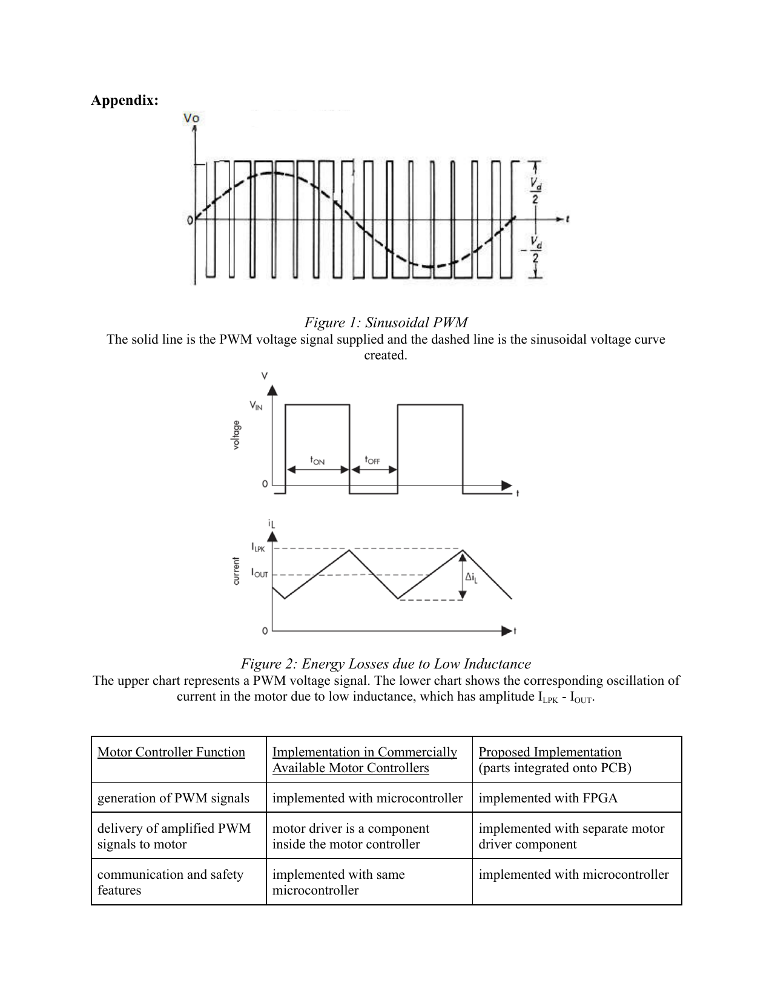
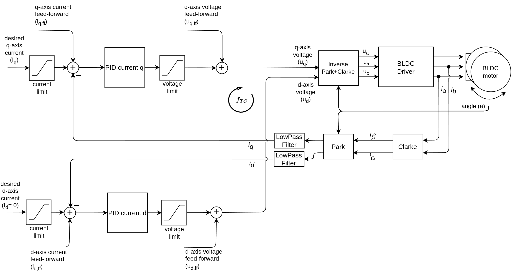
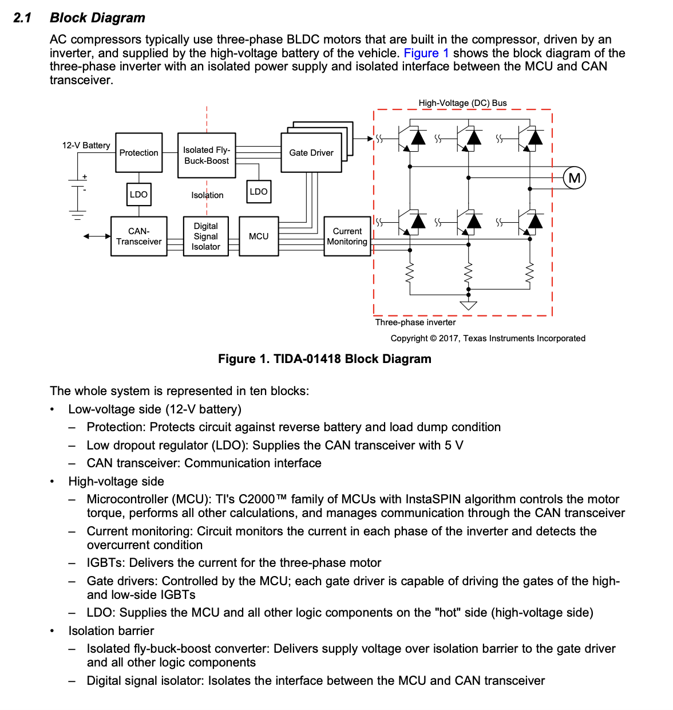
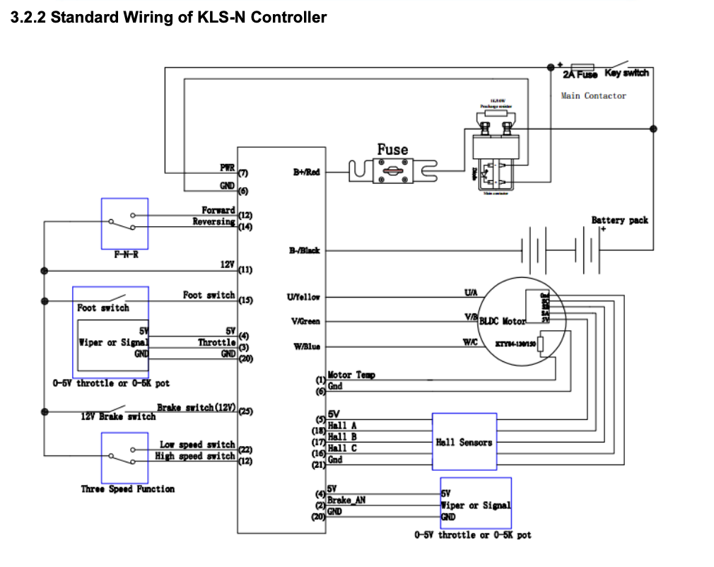
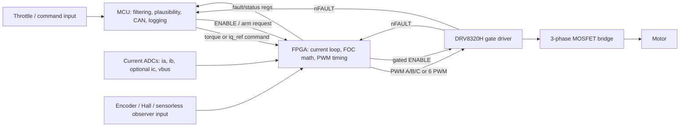
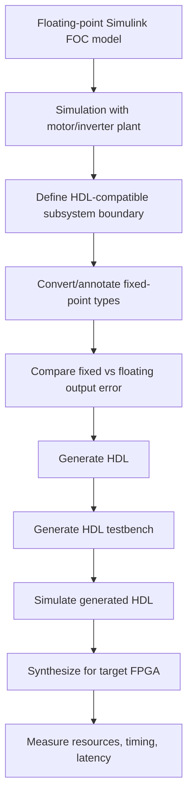
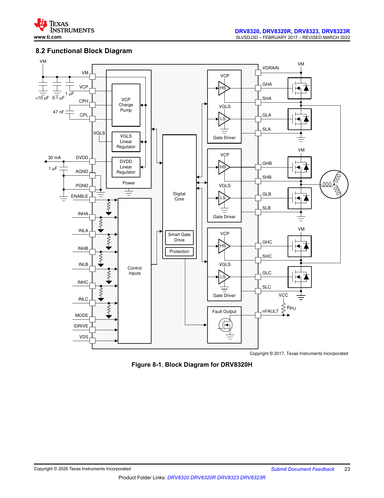
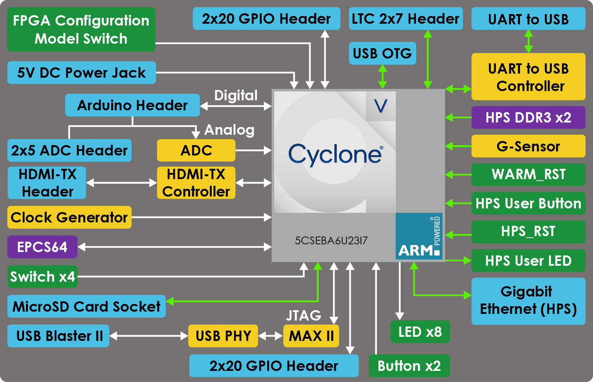
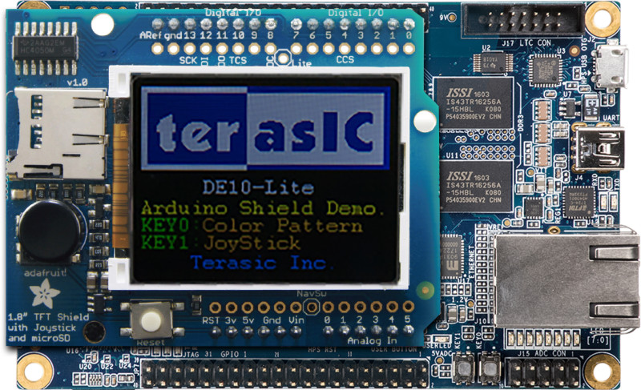

# SURG FPGA/MCU FOC Notes

## 1. What changed from the proposal

proposal frames controller as three functions:

1. FPGA: generate high-frequency PWM using FOC.
2. MCU: telemetry, communication, and safety features.
3. Motor driver: amplify PWM and drive the motor phases.



Source: attached SURG proposal PDF, Appendix figures.

That is still a decent starting architecture but details need to be clearer before PCB is finalized:

- If the FPGA is meant to improve current-control bandwidth, current sensing and rotor-position feedback must reach the FPGA with low latency. If the MCU reads current and sends it to the FPGA slowly, the FPGA advantage mostly disappears.
- If the FPGA only generates PWM from duty-cycle commands produced by an MCU, that is still useful, but that is a smaller project than "FPGA FOC."
- Safety should not be exclusively "MCU" or exclusively "FPGA." The best split is layered: hard analog/gate-driver protections, fast FPGA shutdown/interlocks, and slower MCU supervision/logging/recovery.
- The SimpleFOC DriveShield/DRV8320H direction is a practical low-voltage test platform, but it is 3PWM hardware-configured. That affects how the FPGA pins must be wired.

## 2. Other Notes

Useful links:

- ST STM32N6570-DK: https://www.st.com/en/evaluation-tools/stm32n6570-dk.html
- STM32duino Arduino core: https://github.com/stm32duino/Arduino_Core_STM32
- SimpleFOC STM32 docs: https://docs.simplefoc.com/stm32_mcu

Main point: the STM32N6570-DK is a powerful MCU development board, not an FPGA board. It could be the MCU half of a split architecture, but it cannot replace the FPGA unless the project scope changes.

## 2A. Internal Notes and Spreadsheets Summary

The extra team docs make the current direction way clearer than the original proposal.

### Meeting Notes

`6_21 Meeting notes.docx` is super short:

- Action items.
- BOM.
- Create SimpleFOC shield.

`6_22 Notes.docx` is way more important. It says "No more simple FOC" and defines this split:

| Block | Team note | Interpretation |
|---|---|---|
| MCU | Receives throttle/command, sends target `Iq` to FPGA, logs data, handles CAN, handles slow safety | MCU is supervisor and communications/logging processor. |
| FPGA | Reads current sensors, reads rotor position, runs current-loop FOC, generates SVPWM/PWM, inserts deadtime, handles fast shutdown | This is a true FPGA-accelerated control loop, not just FPGA PWM. |
| Gate driver | Converts 3.3 V FPGA logic to MOSFET gate drive | Gate-driver selection must match bus voltage and MOSFET/IGBT choice. |
| Inverter | Switches 96 V DC bus into U/V/W motor phases | Final system is high voltage relative to DRV8320/SimpleFOC Drive limits. |
| Motor | Sends current/position/temp feedback | Feedback routing is central to PCB architecture. |

This basically matches the architecture we should be aiming for: MCU for command/logging/supervisory safety, FPGA for the deterministic current-control loop and fast shutdown.

### SimpleFOC Notes

`a.f. simplefoc notes.docx` is still useful even if we are moving away from directly using SimpleFOC:

- Target/benchmark motor context includes a QS260 5000 W scooter motor and Kelly Mini KLS9620M controller specs.
- SimpleFOCShield and SimpleFOCDrive are useful learning/prototype references, but their voltage/current ratings are way below the 96 V/high-current target.
- Hall sensors are included on the motor, spaced 120 electrical degrees, and likely need pullups if open-drain/open-collector.
- The SimpleFOC bring-up sequence is still a good staged testing checklist:
  - sensor test
  - driver test
  - open-loop test
  - closed-loop voltage mode
  - estimated-current mode
  - real FOC current-control mode
- The notes identify the important FOC blocks: motor parameters, sensor/driver/current-sensor linking, PWM modulation type, torque mode, motion mode, `motor.init()`, `motor.initFOC()`, `loopFOC()`, and `move(target)`.
- The notes correctly flag that current-mode FOC is the real target if efficiency/current ripple is the research claim.

Useful SimpleFOC current-mode diagram extracted from the team notes:



How to use this diagram for FPGA work:

- Inputs to FPGA: `Iq_ref`, `Id_ref`, phase current samples, electrical angle.
- FPGA math: Clarke, Park, current PI loops, feed-forward if used, inverse Park/Clarke or SVPWM.
- FPGA outputs: PWM duty cycles and gate-driver enable/fault state.

Small nuance: the note "FPGAs do not have interrupts" is directionally useful, but the better wording is that FPGA logic does not usually use CPU-style interrupt service routines. In HDL, you normally build counters, edge detectors, state machines, and handshake logic that run concurrently every clock cycle.

### TI / High-Voltage Inverter Notes

`a.f. TI doc.docx` references TI TIDA-01418, a high-voltage 3-phase inverter design. The key team note is important:

> Monitoring an analog output with an MCU ADC is not sufficient for detecting short-circuit and overcurrent events as fast as possible.

That supports the layered safety take:

- Fast overcurrent protection should happen in hardware/gate-driver/comparator/FPGA logic.
- MCU ADC monitoring is useful for telemetry and slower safety decisions, but not as the only short-circuit protection.

Extracted TI high-voltage inverter block diagram:



Design takeaway:

- High-voltage inverter designs are organized around an isolation boundary.
- Current monitoring is part of the high-voltage side.
- CAN/low-voltage communication can be isolated from the power stage.
- This is closer to a 96 V final system than a low-voltage SimpleFOC shield.

### "To Look Into" Notes

`a.f. to look into.docx` captures many unresolved research questions:

- Motor interface board schematic.
- What makes expensive controllers expensive.
- Fixed-point math on FPGA.
- Component selection for PCB.
- STM32/SoC/MCU+FPGA board.
- HDL Coder and FPGA-in-the-loop simulation.
- Low-voltage motor testing before high-voltage testing.
- SimpleFOC theory corner.
- DC/DC, isolation, motor interface, and component selection.
- Kelly KLS-N wiring and features: throttle, brake, forward/reverse, hall sensors, motor temp, battery/current/temp monitoring, fault detection, regen braking, CAN/Bluetooth.
- High-voltage PCB concerns: creepage, clearance, isolation slots, high/low voltage separation, trace width, fuses, ground planes, and dedicated layers.

Extracted Kelly-style wiring reference:



Useful conclusion: the final controller is not just "FOC math plus PWM." It also needs all the boring-but-crucial system I/O: throttle, foot switch, brake, forward/reverse, hall/position, motor temp, contactor/key switch/fuse, CAN/logging, and fault handling.

### Spreadsheets

`BOM.xlsx` currently lists an early low-voltage/stage-1 setup:

- Driver from AliExpress, about $30.
- Small test motor, about $14.
- STM32 Nucleo-F401RE, about $25.
- S49E Hall sensor.
- Gimbal motor reference.

`components for the pcb.xlsx` currently lists placeholders:

- current sensors x2
- hall sensor pullups
- digital isolators, with TI UCC21550 link
- driver
- SPI
- H-bridge

`RAM Chart.xlsx` is mostly a task skeleton, but the relevant Week 1 tasks are:

- figure out current sensing
- look at schematics of shield vs drive for stage 2
- look into FPGA capabilities and integration for stage 3
- look into SimpleFOC forum for high voltage/FPGA
- look into specific FPGAs
- reach out to companies

`Companies to reach out.xlsx` has high-priority targets that match the technical needs:

- AMD/Xilinx, Intel/Altera, Microchip, Digilent for FPGA/dev-board support.
- JLCPCB/PCBWay for PCB manufacturing.
- Mouser/DigiKey for component support.
- TI, ST, Infineon, MPS, Analog Devices, onsemi, Renesas, NXP for power/motor-control components.
- Kelly, Prohelion, ODrive/VESC vendors for controller benchmarks or advice.

## 3. My Take: Safety on FPGA vs MCU

Your instinct is right for fast protection, but your lead also has a point if they mean "do not put every safety feature in FPGA just because FPGA sounds faster."

Recommended split:

| Safety layer | Where it should live | Why |
|---|---|---|
| Gate-driver hardware protection | DRV8320 / gate driver / analog hardware | Fastest and closest to MOSFETs. Handles undervoltage, charge pump faults, VDS overcurrent, gate-driver faults, overtemperature, and nFAULT. |
| Hard emergency shutdown path | Hardware line into gate-driver ENABLE plus FPGA PWM inhibit | Should work even if firmware is stuck. |
| Fast cycle-by-cycle interlocks | FPGA | Deterministic and can react at PWM/current-loop timescale. Good for PWM inhibit, illegal state prevention, overcurrent windows, encoder validity, and watchdog timeout. |
| Supervisory safety | MCU | Better for state machines, throttle plausibility, precharge/startup sequencing, CAN messages, temperature trends, logging, fault codes, and re-arm policy. |
| Operator/system safety | MCU plus external hardware | E-stop, startup-at-zero throttle, brake input, CAN command validity, user interface, logs. |

Practical rule:

- FPGA should be able to shut the bridge down immediately without asking the MCU.
- MCU should decide whether the system is allowed to run, explain/log faults, and control restart.
- Gate driver/hardware should protect the MOSFETs even if both digital chips are having a bad day.

So the answer is not really "safety on MCU" or "safety on FPGA." The answer is:

> Put fast protection in hardware/FPGA, put policy and recovery in the MCU, and route critical fault lines to both.

## 4. Proposed FPGA/MCU Pipeline

Recommended first full-system split:



Core idea:

- MCU handles slow and human-facing logic.
- FPGA handles deterministic fast loop.
- The gate driver remains the last line of power-stage protection. Do not make the MCU babysit every scary power-stage fault.

## 5. FPGA Work You Should Own

For the FPGA assignment, the strongest things to actually make are:

1. Build a floating-point Simulink FOC reference model.
2. Add a plant model: PMSM/BLDC, inverter, current sensors, encoder.
3. Run open-loop tests first: PWM duty generation, current ripple, voltage commands.
4. Run closed-loop current control: `id_ref = 0`, `iq_ref = throttle/torque command`.
5. Convert the FOC data path to fixed point.
6. Compare fixed-point outputs against floating-point baseline.
7. Generate HDL using HDL Coder for the FOC/PWM subsystem.
8. Generate an HDL testbench and simulate the Verilog/VHDL.
9. Define a pin/register interface for the MCU and PCB team.
10. Produce a latency/resource report: clock frequency, pipeline latency, DSP usage, LUT/FF usage, BRAM usage.

## 6. MATLAB / Simulink / HDL Coder Notes

MathWorks HDL Coder can generate synthesizable Verilog, SystemVerilog, and VHDL from MATLAB functions, Simulink models, and Stateflow charts for FPGA/SoC/ASIC workflows. MathWorks also has Motor Control Blockset examples for FOC on FPGA hardware and an SoC example that partitions FOC between ARM software and programmable logic.

Useful official references:

- HDL Coder getting started: https://www.mathworks.com/help/hdlcoder/getting-started-with-hdl-coder.html
- HDL code generation workflow: https://www.mathworks.com/help/hdlcoder/gs/hdl-code-generation-workflow.html
- FOC of PMSM using FPGA-based motor control kit: https://www.mathworks.com/help/mcb/gs/foc-pmsm-using-mcb-blocks-fpga-hardware.html
- Implement FOC on FPGA SoC: https://www.mathworks.com/help/mcb/gs/implement-foc-on-fpga-soc.html
- Fixed-point conversion in HDL Coder: https://www.mathworks.com/help/hdlcoder/ug/floating-point-to-fixed-point-conversion.html
- Fixed-Point Designer: https://www.mathworks.com/help/fixedpoint/getting-started-with-fixed-point-toolbox.html

Suggested workflow:



Subsystem boundary suggestion:

- Put only the deterministic fast-control path inside the HDL subsystem.
- Keep logging, serial parsing, CAN, and configuration UI outside HDL. That stuff does not need to be in the fast loop.
- Avoid dynamic memory, variable-size arrays, unsupported MATLAB functions, and complex control flow inside the HDL subsystem.

## 7. FOC Algorithm Blocks for HDL

Minimum FOC current-control path:

```text
ia, ib, ic or ia, ib
    -> Clarke transform
    -> Park transform using rotor electrical angle theta_e
    -> id / iq current control PI loops
    -> inverse Park
    -> inverse Clarke or SVPWM / duty generation
    -> PWM compare counters
    -> gate-driver inputs
```

Notes:

- `id` usually controls flux; for surface PMSM/BLDC start with `id_ref = 0`.
- `iq` controls torque; throttle should map mainly to `iq_ref`, not directly to PWM duty.
- Rotor angle is mandatory for sensored FOC. It can come from encoder, Hall sensors with interpolation, resolver, or observer.
- The FPGA should use a consistent per-unit system early. For example: currents, voltages, and duty cycles normalized to `[-1, 1]`.
- PI loops need saturation and anti-windup. Forgetting this will make fixed-point overflow and startup behavior ugly real quick.

## 8. Fixed Point vs Floating Point on FPGA

Floating point:

- Faster to model and debug.
- More dynamic range.
- Easier for initial Simulink reference.
- Costs much more FPGA area and often adds latency.
- Can be acceptable on larger FPGAs, but it fights the project's "cheap efficient controller" goal.

Fixed point:

- More work up front.
- Needs range analysis, scaling, saturation, and careful testbenches.
- Uses FPGA DSP slices efficiently.
- Lower area/power/latency when designed well.
- More appropriate for a compact motor-control datapath.

Development strategy:

1. Start floating point.
2. Add signal logging for all internal ranges: `ia`, `ib`, `id`, `iq`, errors, PI integrators, `vd`, `vq`, `valpha`, `vbeta`, duty.
3. Normalize to per-unit values before fixed-point conversion.
4. Convert to fixed point and compare against floating point.
5. Increase word length only where the error affects torque ripple, stability, or duty output.

Starter Q-format guesses, to be verified by simulation:

| Signal | First-pass type idea | Notes |
|---|---|---|
| Current inputs | signed 16 to 18 bits | Based on ADC resolution and current-sensor scaling. |
| Per-unit current/voltage | signed Q1.15 or Q2.16 | Use enough headroom for overcurrent and modulation limits. |
| Sin/cos | signed Q1.15 | LUT or CORDIC. |
| Park/Clarke products | 24 to 32-bit intermediate | Prevent multiply accumulation overflow. |
| PI integrators | signed 32-bit | Saturate and anti-windup. |
| Duty outputs | unsigned 12 to 16 bits | Match PWM counter resolution. |
| Angle | unsigned 16 to 18 bits circular | Easy wraparound for electrical angle. |

Key risk: fixed-point mistakes do not always look like obvious crashes. They show up as motor noise, torque ripple, unstable current loops, or duty commands stuck at rails. Fun times.

## 9. PWM on the FPGA

If the project goal is high-frequency PWM/current control, PWM generation belongs on the FPGA.

What the FPGA PWM block should include:

- Center-aligned PWM option.
- Synchronous duty update at period boundary.
- Minimum/maximum duty clamp.
- Optional 3PWM or 6PWM output mode.
- Dead-time insertion if using 6PWM.
- Emergency override that forces all outputs safe.
- Fault latch with explicit MCU re-arm.
- Counter resolution report, for example:

```text
PWM frequency = FPGA_clock / PWM_counts

100 MHz clock, 20 kHz PWM -> 5000 counts -> ~12.3 bits
100 MHz clock, 50 kHz PWM -> 2000 counts -> ~11 bits
100 MHz clock, 100 kHz PWM -> 1000 counts -> ~10 bits
```

Do not blindly maximize PWM frequency. Higher PWM frequency reduces current ripple in low-inductance motors, but switching losses and MOSFET heating rise with frequency. The real goal is the best efficiency point, not just "FPGA fast, crank it."

## 10. SimpleFOC / DRV8320H Notes

The SimpleFOC DriveShield v1.2 uses a DRV8320H gate driver in hardware-configured 3PWM mode. The repo describes the board as DRV8320H, hardware configuration, 3PWM, with protections including undervoltage lockout, charge pump fault, MOSFET overcurrent, MOSFET short circuit, gate-driver fault, and overtemperature.

Voltage caveat:

- DRV8320 is a low-voltage MOSFET gate-driver family with a recommended `VM` range up to 60 V.
- Your team notes mention a 96 V DC bus and a Kelly controller operating in the 48-96 V class.
- Therefore, DRV8320/SimpleFOC DriveShield is useful for stage-1 low-voltage learning and small-motor testing, but it is not the right final gate-driver/power-stage choice for a 96 V inverter.
- For the final high-voltage stage, the team should evaluate 100 V+ MOSFET gate-driver options or isolated gate drivers, proper current sensing, isolation, creepage/clearance, and protection architecture.

Useful references:

- SimpleFOC DriveShield GitHub: https://github.com/simplefoc/SimpleFOC-DriveShield
- SimpleFOC 3PWM driver docs: https://docs.simplefoc.com/bldcdriver3pwm
- SimpleFOC 6PWM driver docs: https://docs.simplefoc.com/bldcdriver6pwm
- TI DRV8320 datasheet: https://www.ti.com/lit/ds/symlink/drv8320.pdf

DRV8320H block diagram:



Source: TI DRV8320 datasheet, Figure 8-1.

DRV8320 interpretation:

- `VM` is the motor/gate-driver power input.
- `VDRAIN` senses the high-side MOSFET drain bus for VDS monitoring.
- `GHA/GHB/GHC` drive high-side MOSFET gates.
- `GLA/GLB/GLC` drive low-side MOSFET gates.
- `SHA/SHB/SHC` are the switching/source nodes and motor phase outputs.
- `SLA/SLB/SLC` are low-side source sense/reference pins.
- `nFAULT` should go to both FPGA and MCU.

3PWM vs 6PWM:

- In 6PWM mode, `INHA/INLA`, `INHB/INLB`, and `INHC/INLC` are direct high/low control pairs.
- In 3PWM mode, `INHA/INHB/INHC` are the three PWM phase commands.
- In 3PWM mode, `INLA/INLB/INLC` become Hi-Z controls for the half bridges. If Hi-Z is not needed, TI says they can be tied high.
- The SimpleFOC DriveShield ties these low-side input pins to enable so the board globally enables or disables the phases.

Implication for FPGA:

- If using this shield as-is, output 3 PWM signals plus enable.
- If you want true 6PWM from the FPGA, the PCB must not tie `INLA/B/C` to `ENABLE`, and the DRV8320 mode resistor must select 6PWM.
- 6PWM gives more direct control but more chances to create shoot-through if dead-time/fault logic is wrong.
- 3PWM is simpler and probably better for a first low-voltage prototype.
- For the final 96 V architecture, do not assume the SimpleFOC DriveShield schematic can be scaled up by changing MOSFETs. The gate driver, isolation, protection, layout, and sensing approach all need a high-voltage design pass.

## 11. Current Sensing and ADC Routing

This is probably the biggest architecture decision for FPGA usefulness.

For FPGA FOC, the FPGA needs current samples in time to compute the next PWM update. Options:

| Option | Description | Pros | Cons |
|---|---|---|---|
| External ADC direct to FPGA | Current sensors feed ADC, ADC SPI/parallel goes to FPGA | Best deterministic loop | More PCB complexity; need ADC timing work |
| MCU ADC then send to FPGA | MCU samples current and streams data to FPGA | Simpler if MCU has good ADC | Latency and jitter may ruin FPGA advantage |
| SoC FPGA with ADC expansion | FPGA board has ADC or compatible ADC shield | Good for prototyping | Board-specific, may not match final PCB |
| Use MCU for FOC, FPGA only PWM | MCU does current loop, FPGA does PWM timing/interlocks | Easier integration | Less compelling research claim |

My take:

> If the research claim is FPGA-accelerated FOC, route current and position feedback directly to the FPGA or to an FPGA-adjacent ADC interface. Let the MCU see copies or summaries for logging.

Current sensor questions for PCB:

- Are phase currents measured inline, low-side shunt, or DC bus only?
- Are current sensors analog output, SPI ADC, isolated amplifier, or hall-effect modules?
- What sample rate and latency are required?
- Can the ADC sample synchronously with PWM center points?
- Is the ADC interface routed to FPGA pins, MCU pins, or both?
- What is the current-sensor bandwidth compared to the target PWM/current-loop frequency?

## 12. Rotor Position / Sensor Inputs

For sensored FOC, the FPGA needs electrical angle:

```text
theta_e = pole_pairs * theta_mech + offset
```

Possible inputs:

- Quadrature encoder A/B/Z.
- Hall sensors.
- SPI/I2C magnetic encoder.
- Resolver interface.
- Sensorless observer, later.

My take:

- Start with quadrature encoder or magnetic SPI encoder if the motor setup supports it.
- FPGA is excellent for quadrature counting and timestamping.
- MCU can perform calibration commands and log speed/position, but FPGA should have the real-time angle used by the current loop.

## 13. Board/SoC Notes

### STM32N6570-DK

ST describes STM32N6570-DK as a Discovery kit for the Arm Cortex-M55 based STM32N657X0H3Q microcontroller. It is strong as an MCU board, but it is not an FPGA/SoC FPGA.

Use it for:

- MCU-only baseline.
- Supervisory MCU in a split prototype.
- CAN/telemetry/logging.
- Running SimpleFOC on STM32 for comparison.

Do not use it as:

- The FPGA part of the project.

Source: https://www.st.com/en/evaluation-tools/stm32n6570-dk.html

### Terasic DE10-Nano

The DE10-Nano is a true SoC FPGA board based on Cyclone V SoC with dual-core ARM Cortex-A9 plus FPGA fabric. It also has Arduino Uno R3 compatible expansion headers.





Sources:

- Terasic DE10-Nano product page: https://www.terasic.com.tw/cgi-bin/page/archive.pl?CategoryNo=167&Language=English&No=1046
- Intel DE10-Nano page: https://www.intel.com/content/www/us/en/developer/topic-technology/edge-5g/hardware/fpga-de10-nano.html
- DE10-Nano user manual via Mouser: https://www.mouser.com/datasheet/2/598/DE10_Nano_User_manual_a_b-1108056.pdf

Why it fits the split:

- FPGA fabric can run PWM/FOC.
- ARM cores can act like the MCU supervisor.
- Arduino header may allow shield-style prototyping.
- Existing docs confirm Arduino Uno R3 compatibility, but voltage levels and analog routing still need checking.

### Digilent Arty A7

The Arty A7 is an Artix-7 FPGA board with an Arduino/chipKIT shield connector. It is not a hard-processor SoC, but can run a MicroBlaze soft processor if desired.

Use it for:

- Pure FPGA PWM/FOC prototyping.
- MCU connected separately.
- Learning HDL Coder/Vivado flow.

Concern:

- Not a true FPGA/MCU split unless you add external MCU or use soft processor.

Source: https://digilent.com/reference/programmable-logic/arty-a7/reference-manual

### Zynq/MPSoC Boards

Boards based on Xilinx Zynq/Zynq UltraScale+ are conceptually ideal for this project because they contain ARM processors plus programmable logic on the same device. MathWorks' "Implement FOC on FPGA SoC" example uses a Trenz Electronic Motor Control Development Kit based on Xilinx Zynq UltraScale+ MPSoC.

Use these for:

- ARM software + FPGA logic partitioning.
- HDL Coder/Embedded Coder co-design.
- Higher-end reference implementation.

Concern:

- Cost and setup complexity can be much higher than a simple MCU + FPGA board.

Source: https://www.mathworks.com/help/mcb/gs/implement-foc-on-fpga-soc.html

## 14. PCB Questions

Questions to bring up before the schematic gets locked:

1. Which exact gate driver is the PCB using: DRV8320H, DRV8323, or something else?
2. Is the gate driver configured for 3PWM or 6PWM?
3. If 3PWM, are `INLA/B/C` tied to enable like the SimpleFOC DriveShield?
4. If 6PWM, where is dead-time generated: FPGA, MCU timer, or gate driver?
5. Which chip physically drives `ENABLE`?
6. Does `nFAULT` go to FPGA, MCU, or both?
7. Is there a hardware pull-down on `ENABLE` so the bridge is off at reset?
8. Is there an emergency-stop path that disables the gate driver without firmware?
9. Where do current sensor outputs go: FPGA ADC path, MCU ADC, or both?
10. What ADC sample rate and resolution are planned?
11. Are phase currents sampled inline, low-side, or only DC bus?
12. What rotor position sensor is expected?
13. Does the FPGA get the raw rotor position signal?
14. What logic voltage is used: 3.3 V, 2.5 V, 1.8 V?
15. Are all Arduino-header pins 3.3 V tolerant only?
16. Does the motor driver shield expect 5 V logic or 3.3 V logic?
17. How is `VM`/battery bus measured?
18. Are MOSFET temperature or board temperature sensors included?
19. What is the target PWM frequency range?
20. What is the target current-loop frequency?
21. What is the target motor bus voltage and max phase current?
22. What is the intended first test motor before the Mitsuba?
23. How will the MCU and FPGA communicate: SPI, UART, parallel registers, AXI, CAN, or shared SoC bus?
24. Who owns startup sequencing and re-arming after faults?
25. Is the board meant to be Arduino-shield compatible mechanically only, or electrically/software compatible too?
26. Is this PCB a low-voltage learning board or the 96 V inverter board? These should probably not be the same first revision.
27. If targeting 96 V, what gate-driver voltage rating and isolation strategy are being used?
28. What creepage/clearance rules are being applied between HV bus, phases, logic, and communication lines?
29. Is CAN isolated from the high-voltage inverter side?
30. Is there a hardware comparator or gate-driver protection path for short-circuit shutdown faster than an MCU ADC loop?
31. Where are fuses/contactors/precharge/key-switch signals handled?
32. Are motor temperature and MOSFET/PCB temperature available to the MCU, FPGA, or both?

## 15. First Simulation Plan

Start with simulation before choosing final HDL details. Otherwise we are just guessing with extra steps.

### Simulation 1: PWM/current-ripple comparison

Goal:

- Prove the proposal's claim that higher PWM frequency reduces current ripple for a low-inductance motor.

Inputs:

- Simple RL phase model or PMSM model.
- Bus voltage.
- Motor resistance and inductance.
- PWM frequencies: 10 kHz, 20 kHz, 50 kHz, 100 kHz.

Outputs:

- Current ripple peak-to-peak.
- RMS current.
- Estimated copper loss.
- Switching-loss warning, even if approximate.

### Simulation 2: Floating-point FOC

Goal:

- Validate correct FOC behavior before fixed-point conversion.

Tests:

- Step `iq_ref`.
- Step speed/load.
- Startup angle offset error.
- Current limit.
- Bus voltage sag.
- Sensor noise.

### Simulation 3: Fixed-point FOC

Goal:

- Compare fixed-point against floating-point baseline.

Metrics:

- `id/iq` error.
- duty error.
- torque ripple proxy.
- PI saturation behavior.
- overflow events.

### Simulation 4: HDL-generated subsystem

Goal:

- Verify generated HDL matches fixed-point Simulink.

Tests:

- HDL testbench from HDL Coder.
- Corner cases: zero speed, high speed, max current, fault asserted, enable false, angle wraparound.

## 16. FPGA Register / Interface Sketch

Possible MCU-to-FPGA registers:

| Register | Direction | Purpose |
|---|---|---|
| `run_enable` | MCU to FPGA | Request motor control enabled. |
| `iq_ref` | MCU to FPGA | Torque command after throttle filtering. |
| `id_ref` | MCU to FPGA | Usually 0, later field weakening. |
| `current_limit` | MCU to FPGA | Clamp current loop. |
| `speed_limit` | MCU to FPGA | Optional speed clamp. |
| `fault_clear` | MCU to FPGA | Explicit re-arm/clear request. |
| `mode` | MCU to FPGA | Open-loop, closed-loop, calibration, disabled. |

Possible FPGA-to-MCU registers:

| Register | Direction | Purpose |
|---|---|---|
| `fault_flags` | FPGA to MCU | Latched fault reason. |
| `ia/ib/ic` | FPGA to MCU | Decimated current telemetry. |
| `id/iq` | FPGA to MCU | Control-loop telemetry. |
| `theta/speed` | FPGA to MCU | Position/speed telemetry. |
| `duty_a/b/c` | FPGA to MCU | PWM telemetry. |
| `loop_counter` | FPGA to MCU | Timing/debug. |
| `latency_cycles` | FPGA to MCU | Debug/performance. |

## 17. What to Learn Next

High priority:

- HDL Coder compatible Simulink blocks.
- Fixed-Point Designer workflow.
- Motor Control Blockset HDL support.
- PI controller fixed-point saturation/anti-windup.
- CORDIC vs sin/cos LUT.
- SVPWM vs sine PWM.
- Center-aligned PWM and synchronized ADC sampling.
- DRV8320 3PWM truth table and fault behavior.
- FPGA timing closure basics.

Medium priority:

- Zynq/SoC AXI register interface.
- Quadrature decoder HDL.
- SPI ADC controller HDL.
- HDL cosimulation with ModelSim/Questa or vendor simulator.
- Resource/latency tradeoffs for native floating point.

Later:

- Sensorless observer.
- Field weakening.
- MTPA.
- Hardware-in-the-loop plant model on FPGA.

## 18. Recommended Near-Term Decision

For the next few days, I would push the team toward a two-stage prototype definition.

Stage 1 should prove the control architecture at low voltage:

```text
Low-voltage prototype:
  MCU: handles throttle, CAN/logging, startup state machine, re-arm
  FPGA: receives iq_ref, reads current + position, runs current-loop FOC, generates PWM/SVPWM
  Gate driver: low-voltage MOSFET gate driver or off-the-shelf low-voltage driver
  Safety: nFAULT to both FPGA and MCU; FPGA gates PWM/ENABLE; MCU logs and re-arms
  Test motor: small low-voltage BLDC/PMSM first
```

Stage 2 should be a separate high-voltage inverter effort:

```text
96 V-class prototype:
  Gate driver: selected for 96 V bus plus transient margin
  Power stage: MOSFETs, current sensors, DC-link capacitors, thermal design, fusing
  Isolation: CAN/logic/measurement isolation defined intentionally
  Protection: gate-driver faults + hardware overcurrent + FPGA fast shutdown + MCU supervisory policy
  Layout: creepage, clearance, phase-current paths, Kelvin sense, ground strategy
```

This gives us a real FPGA FOC story while keeping the first hardware revision survivable. It also avoids accidentally treating the SimpleFOC/DRV8320 ecosystem like it is magically 96 V-ready. It is not.

## 19. Sources

- Attached proposal: `Spencer Kogoma - SURG_ Cost and Energy Efficiency of FPGA-Based Field Oriented Control for Lightweight Motors - Google Docs.pdf`
- Attached chat export: `pasted-text.txt`
- Internal meeting notes: `6_21 Meeting notes.docx`
- Internal architecture notes: `6_22 Notes.docx`
- Internal SimpleFOC notes: `a.f. simplefoc notes.docx`
- Internal TI notes: `a.f. TI doc.docx`
- Internal research task list: `a.f. to look into.docx`
- Internal PCB notes: `Top PCB for driver.docx`
- Internal spreadsheets: `BOM.xlsx`, `components for the pcb.xlsx`, `RAM Chart.xlsx`, `Companies to reach out.xlsx`
- MathWorks HDL Coder getting started: https://www.mathworks.com/help/hdlcoder/getting-started-with-hdl-coder.html
- MathWorks HDL workflow: https://www.mathworks.com/help/hdlcoder/gs/hdl-code-generation-workflow.html
- MathWorks FOC on FPGA kit: https://www.mathworks.com/help/mcb/gs/foc-pmsm-using-mcb-blocks-fpga-hardware.html
- MathWorks Implement FOC on FPGA SoC: https://www.mathworks.com/help/mcb/gs/implement-foc-on-fpga-soc.html
- MathWorks fixed-point conversion: https://www.mathworks.com/help/hdlcoder/ug/floating-point-to-fixed-point-conversion.html
- MathWorks Fixed-Point Designer: https://www.mathworks.com/help/fixedpoint/getting-started-with-fixed-point-toolbox.html
- SimpleFOC DriveShield: https://github.com/simplefoc/SimpleFOC-DriveShield
- SimpleFOC 3PWM docs: https://docs.simplefoc.com/bldcdriver3pwm
- SimpleFOC 6PWM docs: https://docs.simplefoc.com/bldcdriver6pwm
- SimpleFOC STM32 docs: https://docs.simplefoc.com/stm32_mcu
- TI DRV8320 datasheet: https://www.ti.com/lit/ds/symlink/drv8320.pdf
- ST STM32N6570-DK: https://www.st.com/en/evaluation-tools/stm32n6570-dk.html
- STM32duino Arduino core: https://github.com/stm32duino/Arduino_Core_STM32
- Terasic DE10-Nano product page: https://www.terasic.com.tw/cgi-bin/page/archive.pl?CategoryNo=167&Language=English&No=1046
- Intel DE10-Nano page: https://www.intel.com/content/www/us/en/developer/topic-technology/edge-5g/hardware/fpga-de10-nano.html
- Digilent Arty A7 reference manual: https://digilent.com/reference/programmable-logic/arty-a7/reference-manual
