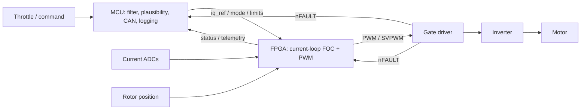

# FPGA/MCU Architecture Notes

## Recommended Split

## MCU Responsibilities

- Throttle input filtering.
- Throttle plausibility checks.
- Startup state machine.
- CAN communication.
- Logging and telemetry.
- Slow safety and policy decisions.
- Fault explanation and re-arm.
- User commands and configuration.

## FPGA Responsibilities

- Read or receive phase current samples.
- Read rotor position.
- Compute Clarke/Park transforms.
- Run `id/iq` current PI loops.
- Generate inverse transforms or SVPWM.
- Generate PWM counters/compare outputs.
- Insert deadtime if using 6PWM.
- Enforce minimum/maximum duty.
- Latch fast faults.
- Inhibit PWM immediately on serious fault.

## Gate Driver / Hardware Responsibilities

- Convert logic PWM to gate drive.
- Protect against gate-driver faults.
- Protect against undervoltage/charge-pump faults.
- Report `nFAULT`.
- Provide fast power-stage protection if supported.

## Safety Philosophy

Use layered safety:

- Hardware/gate driver protects the power stage.
- FPGA handles fast deterministic shutdown.
- MCU handles policy, logging, and restart.

Do not rely on only the MCU ADC loop for short-circuit protection.

## 3PWM vs 6PWM

3PWM:

- Simpler.
- Gate driver handles complementary switching internally.
- Good first prototype choice.
- Less direct control.

6PWM:

- FPGA directly controls high-side and low-side signals.
- Requires correct deadtime and shoot-through prevention.
- Better for full custom inverter control.
- Higher risk if logic is wrong.

## Current Best Direction

For stage 1:

- Low-voltage motor.
- FPGA current loop.
- 3PWM or 6PWM depending on available gate driver.
- Conservative current limits.

For stage 2:

- Separate 96 V inverter design.
- Proper high-voltage gate driver/isolation/protection.

