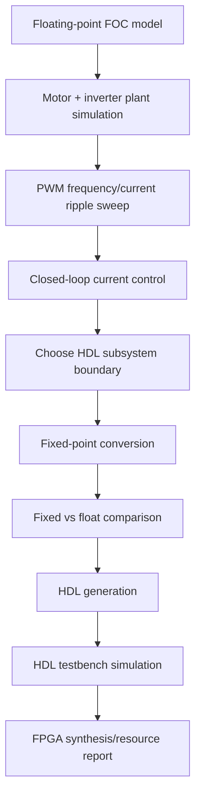

# MATLAB, Simulink, and HDL Coder Plan

## Goal

Use MATLAB/Simulink to build the FOC model first, then slowly turn it into something HDL-friendly instead of jumping straight into Verilog and suffering.

## Workflow

## Simulation 1: PWM Ripple

Purpose:

- Check the proposal's claim that higher PWM frequency reduces current ripple for low-inductance motors.

Sweep:

- 10 kHz
- 20 kHz
- 50 kHz
- 100 kHz

Outputs:

- Current ripple peak-to-peak.
- RMS current.
- Approximate copper loss.
- Switching-loss warning.

## Simulation 2: Floating-Point FOC

Build:

- Clarke transform.
- Park transform.
- `id/iq` PI controllers.
- Voltage limiting.
- Inverse Park/Clarke or SVPWM.
- PWM duty generation.

Tests:

- `iq_ref` step.
- `id_ref = 0`.
- Rotor angle offset.
- Current limit.
- Bus-voltage sag.
- Sensor noise.

## Simulation 3: Fixed-Point Conversion

Use logged ranges from floating-point simulation to choose fixed-point types.

Compare:

- `id/iq` error.
- duty-cycle error.
- saturation events.
- overflow events.
- control stability.

## Simulation 4: HDL Testbench

Generate HDL and testbench from HDL Coder.

Test:

- zero speed.
- high speed.
- max current.
- angle wraparound.
- enable low.
- fault asserted.
- ADC noisy input.

## HDL Subsystem Boundary

Put these inside HDL:

- Clarke/Park.
- PI current loops.
- inverse transforms/SVPWM.
- PWM counters.
- deadtime.
- fault inhibit.

Keep these outside HDL:

- CAN.
- logging.
- serial commands.
- long-term state machine.
- UI/configuration.

## Sources

- MathWorks HDL Coder: https://www.mathworks.com/help/hdlcoder/
- MathWorks Motor Control Blockset: https://www.mathworks.com/help/mcb/
- HDL code generation workflow: https://www.mathworks.com/help/hdlcoder/gs/hdl-code-generation-workflow.html
