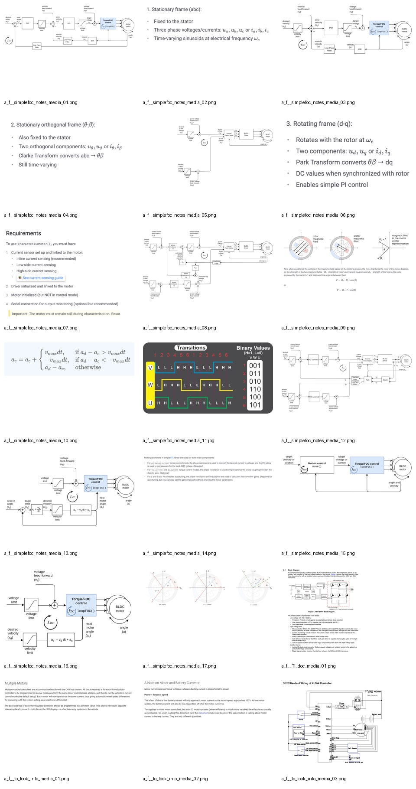

# Image Asset Index

These images are stored locally under `assets/`.

## Main Extracted Images

Proposal figure page:


DRV8320H page 23 block diagram:


DE10-Nano block diagram:


DE10-Nano Arduino header image:


## Team Notes Images

SimpleFOC current-mode FOC diagram:


TI high-voltage inverter block diagram:


Kelly controller wiring reference:


Contact sheet of extracted images:



## How to Embed Images in Markdown

Use:

```md

```

Example:

```md

```

If you paste the Markdown into Google Docs directly, images may not automatically import. If you view it in VS Code, GitHub, Obsidian, or many Markdown viewers, the images will show as long as the relative paths stay valid.
